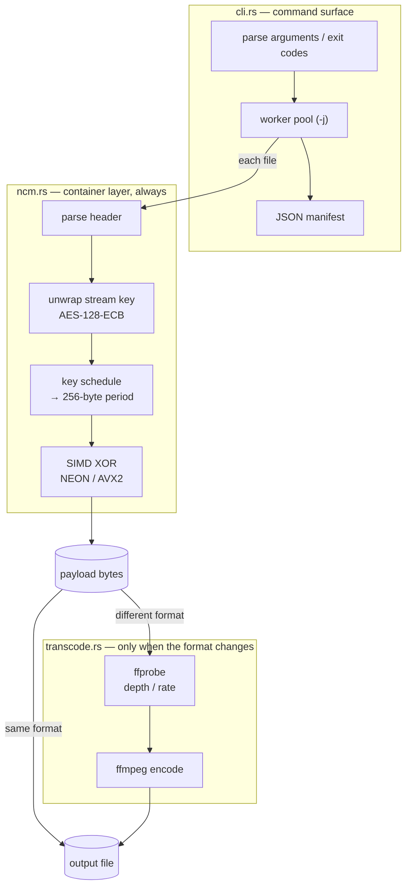
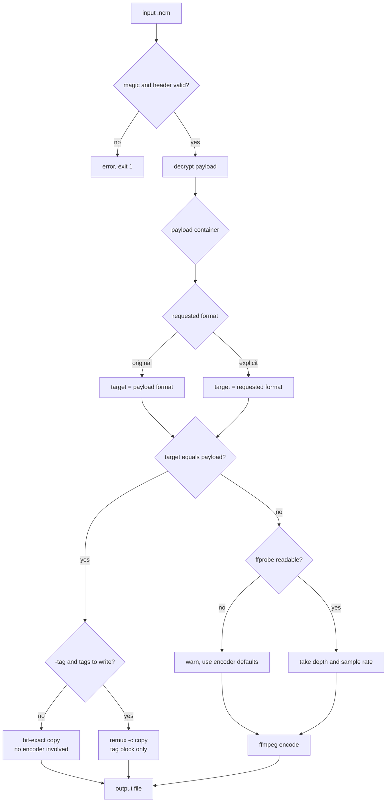
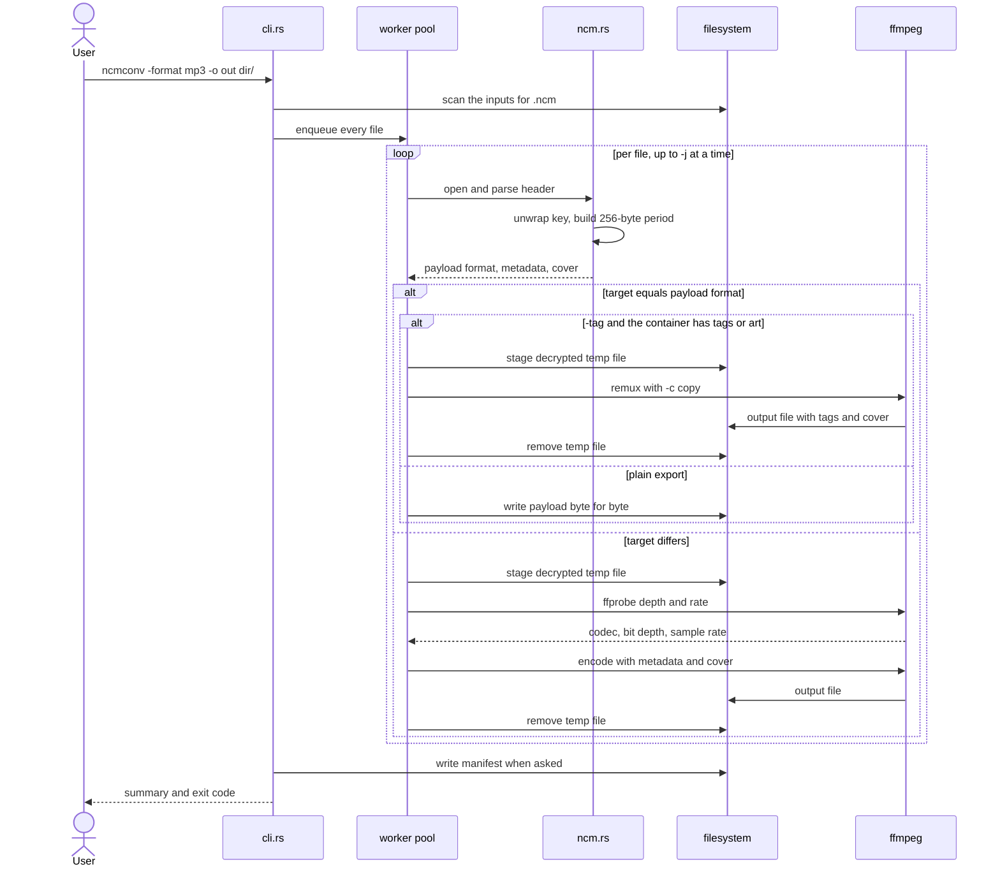

[](https://crates.io/crates/ncmconv)
[](https://github.com/ByteFluffy/ncmconv/actions/workflows/ci.yml)

# ncmconv

Decrypt NetEase Cloud Music `.ncm` files and convert them to open formats.
One static binary, three dependencies, SIMD decryption.

```
ncmconv ~/Music/*.ncm                          # bit-exact export, original format
ncmconv -format mp3 -o ~/out ~/Music           # transcode to 320 kbps MP3
ncmconv -r -format wav -o ~/out ~/Music        # recursive, 24-bit WAV
```

## The one thing to understand first

**`.ncm` is not an audio format.** It is an encrypted container whose payload is
the untouched file the player received — usually MP3 or FLAC — plus tags and
cover art. So the default mode decrypts and writes the payload **byte for byte**:
no decoder, no encoder, no generation loss.

That distinction decides the design:

| You ask for | What happens | Lossless? |
|---|---|---|
| `-format original` (default) | payload copied bit-exactly | yes |
| `-format mp3` on an MP3 payload | payload copied bit-exactly, `-b` is ignored | yes |
| `-format mp3` on a FLAC payload | ffmpeg encode at `-b` | no, by definition |
| `-format wav` / `m4a` / `mp4` | ffmpeg encode | wav yes, aac no |

`mp4` and `m4a` carry the same AAC bitstream; only the container extension
differs. `mp4` exists because players and upload forms ask for it by name.

## Install

One line, verified against the release checksum:

```sh
curl -fsSL https://raw.githubusercontent.com/ByteFluffy/ncmconv/main/install.sh | sh
```

Homebrew. The formula lives in this repository, so the tap points at it:

```sh
brew tap ByteFluffy/ncmconv https://github.com/ByteFluffy/ncmconv
brew install ByteFluffy/ncmconv/ncmconv
```

`scripts/update-formula.sh v0.x.y` refreshes `Formula/ncmconv.rb` from a
release's `checksums.txt`, so the formula never drifts behind the binaries.

With a Rust toolchain:

```sh
cargo install ncmconv
```

Or from a checkout:

```sh
cargo build --release && cp target/release/ncmconv ~/.local/bin/
```

Downloaded binaries arrive quarantined on macOS; clear the flag once:

```sh
xattr -d com.apple.quarantine ~/.local/bin/ncmconv
```

Release archives also ship with `checksums.txt`:

```sh
shasum -a 256 -c checksums.txt --ignore-missing
```

Format conversion needs `ffmpeg` and `ffprobe` on `PATH`
(`brew install ffmpeg`). The default `-format original` mode never touches them,
so a decrypt-only build has no runtime dependencies at all.

## Usage

```
ncmconv [options] <file-or-dir>...
```

| Flag | Default | Meaning |
|---|---|---|
| `-o DIR` | next to each source | output directory |
| `-format F` | `original` | `original`, `mp3`, `flac`, `wav`, `m4a`, `mp4` |
| `-b RATE` | `320k` | bitrate for mp3 / m4a / mp4 |
| `-r` | off | recurse into subdirectories |
| `-j N` | CPU count | parallel workers |
| `-overwrite` | off | replace existing outputs (otherwise skip) |
| `-tag` | off | rewrite the container to attach tags and cover art, audio copied as-is |
| `-info` | off | print what each container holds and convert nothing |
| `-force` | off | encode even when the payload already matches the target |
| `-manifest PATH` | none | also write a JSON manifest |
| `-version` | | print version |

Behaviour that is guaranteed, not incidental:

- **Sources are never deleted, never modified.** No flag changes that.
- **Idempotent.** A second run skips everything already produced; `-overwrite`
  is the only way to replace a file.
- **Output names keep the source basename.** `Artist - Title.ncm` becomes
  `Artist - Title.mp3`. Renaming from tags would let two versions of the same
  song overwrite each other.
- **Exit codes:** `0` all good, `1` at least one file failed, `2` bad arguments.
- **Loud about pointless work.** Re-encoding an already-lossy payload warns;
  ignoring `-b` because the target equals the payload format says so.
- **Metadata and cover art** from the container are written into every
  transcoded target that has a cover slot: `mp3`, `flac`, `m4a`, `mp4`.
- **`-tag` keeps the audio and rewrites only the container.** It uses ffmpeg's
  stream copy, so a decoded comparison of input and output is identical; the
  difference is a real ID3/Vorbis tag block plus the cover instead of the bare
  payload the player shipped. Without `-tag` the export stays byte-exact.

## Recipes

```sh
# what is actually inside these files, before picking a format
ncmconv -info ~/Music/网易云音乐/*.ncm

# archive with tags the player will show
ncmconv -tag -o ~/archive ~/Music/网易云音乐

# small enough to upload, good enough to analyse
ncmconv -format mp3 -b 320k -o ~/upload ~/Music/网易云音乐

# a colleague gets the files and a record of what was produced
ncmconv -r -tag -manifest out/manifest.json -o out ~/Music/网易云音乐

# PCM for an editor that refuses compressed input
ncmconv -format wav -o ~/edit hi-res.ncm
```

## Architecture

Four modules, one direction of dependency. The middle two are the whole tool:

| Module | Job |
|---|---|
| `src/main.rs` | exit code only |
| `src/cli.rs` | argument parsing, work queue, progress, manifest |
| `src/ncm.rs` | header parse, AES-128-ECB key unwrap, key schedule, SIMD XOR |
| `src/transcode.rs` | ffmpeg/ffprobe invocation; exists only when a format changes |



### Which path a file takes

The only real decision in the tool is whether the payload needs an encoder at
all. Same container means a byte copy; anything else means ffmpeg.



### One conversion, end to end



Two invariants hold the design together:

1. **Same format never reaches an encoder.** The container layer produces raw
   bytes; the output layer decides whether they need transcoding at all.
2. **No encoder is ever implemented here.** MP3, AAC, FLAC and PCM all come from
   ffmpeg; this tool only makes the parameter decisions.

Rust rather than C: same speed ceiling, but the parser consumes untrusted files
(attacker-supplied lengths and frames), where an out-of-bounds read is a security
bug rather than a crash.

## Performance

The container's key schedule has a period of 256 bytes, so decryption is a table
XOR with a repeating pattern — vectorised with NEON on aarch64 and AVX2 on
x86-64, with a scalar reference path for everything else.

Measured on an M5 Pro, 150 MiB payload:

| Implementation | Throughput | 150 MiB |
|---|---|---|
| scalar | 3.3 GB/s | 45 ms |
| **NEON (shipped)** | **42 GB/s** | **3.6 ms** |

At that point the decrypt is bounded by disk I/O, not CPU. Conversion is not:
one 5:51 track costs

| Stage | Time |
|---|---|
| decrypt + bit-exact export | ~0.02 s |
| → FLAC | 1.7 s |
| → MP3 320k | 2.7 s |
| → WAV 16-bit | 2.9 s |
| → AAC 320k (ffmpeg default encoder) | 8.4 s |
| → AAC 320k (`-aac_coder fast`) | 3.0 s |

So `m4a`/`mp4` are the slow targets because of ffmpeg's default AAC encoder,
not because of this tool. `-j` parallelises across files.

## Agent skill

The repository ships the skill that wraps this CLI at
[`skill/ncm-convert/SKILL.md`](skill/ncm-convert/SKILL.md). Link it where your
agent runtime looks for skills so the instructions stay in one place:

```sh
mkdir -p ~/.agents/skills/ncm-convert
ln -sf "$PWD/skill/ncm-convert/SKILL.md" ~/.agents/skills/ncm-convert/SKILL.md
```

## Verification

The decryptor is not "probably right":

- 18 real `.ncm` files were decrypted and compared against the established C++
  reference implementation by hashing the decoded PCM: **18/18 identical**. That
  set includes a 192 kHz / 24-bit FLAC container with cover art, where the
  extracted cover also matches the reference byte for byte.
- `cargo test` covers the container parser (metadata, cover frames, cover
  padding), the keystream against a pinned vector, the vectorised path against
  the scalar reference at every length, and an ffmpeg matrix for every target
  format plus cover embedding.
- `cargo test --release bench_decrypt -- --ignored --nocapture` reproduces the
  throughput numbers above.

## Known limitations

- `-format` equal to the payload format copies unless `-tag` or `-force` is
  given; only `-force` re-encodes.
- Lossy targets clamp anything above 48 kHz automatically; the rate cannot be
  set explicitly.
- Release binaries are unsigned, so macOS Gatekeeper quarantines the download.
- No checksums are published with the release artifacts.

## Legal

This is a personal-use tool for files you already have on your own machine. It
circumvents a technical protection measure, so redistributing the decrypted
audio, or shipping this in a product, is a different question — check the law
where you are. No license is granted to the underlying music.
